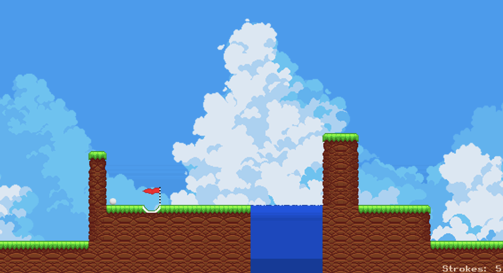

# GoGolf

A 2D side-scrolling arcade golf game built in Python and Pygame. You play through each course in as few strokes and as little time as possible to set a high score. Playing earns coins, which you can spend on golf ball skins.

I built it as my Foundation Year project at the University of Sussex (2024). In 2026 I came back to it and fixed security issues and bugs.



📄 **[Project report](docs/GoGolf-Report.pdf)**: background research, design, ERD, UML, test plans and evaluation (60 pages)

## Features

- **Ball physics:** projectile motion with gravity, air resistance and ball mass. Bounce damping and x/y tile collisions slow the ball down or change its path.
- **Aiming:** shot power is set by the cursor's distance from the ball and capped at 1000. The angle comes from `atan2`, and the aim line changes colour with power.
- **Camera:** the camera follows the ball in flight. Before each shot you can scroll freely to scout the course.
- **Level editor:** design levels on a tile grid, then save and load them with `pickle`.
- **Three game modes:**
  - **3 Holes** and **5 Holes** are competitive. They use fixed courses, and results are saved to leaderboards.
  - **Random** is quick play. It picks one of 7 courses, and results are not saved.
- **Scoring algorithm:** rewards fewer strokes and faster times (see [Scoring](#scoring)).
- **Accounts and database:** a normalised SQLite database stores users, results for each mode, coins and owned skins.
- **Leaderboards:** sort by score, strokes or time, and page through the results.
- **Skin shop:** spend the coins you earn on 7 golf ball colours.

## Scoring

Each level starts at **1000 points per hole**. A divider is chosen based on how many strokes you took:

| Strokes | Divider |
|---|---|
| 0–9 | 14 |
| 10–15 | 10 |
| 16–20 | 8 |
| 21–28 | 6 |
| 29–35 | 2 |
| 36+ | −strokes / 10 |

```
level score = round((starting score / (time / divider)) × 100)
```

The level scores are added together to give the final total.

## Design highlights

- **OOP throughout.** `Tile` is a superclass with `Water` and `Goal` subclasses. `Goal` overrides behaviour so it can draw the flag while the hole is still active.
- **Data structures written from scratch.** A queue loads each course's levels in order. The project also has a stack and merge sort.
- **Viewport culling.** A NumPy mask over the tile x-coordinates means only tiles on screen are drawn.
- **Frame-rate tuning.** I profiled Level 1 at a target of 100 FPS and at 60 FPS. At 100 FPS the average was only 76.7, with drops to 51. At 60 FPS the average was 59.98 and the lowest was 53.2, so I locked the game to 60 for smoother play.
- **Logging.** Every run writes a timestamped log file. I used these logs as evidence in the test plans for both the game and the editor.

## Security updates (2026)

When I came back to the project I fixed two issues that the original evaluation had flagged:

- **SQL injection:** queries used to build SQL with f-strings. They now use parameterised `?` queries, and any table or column names that come from variables are checked against a whitelist.
- **Password storage:** passwords used to be stored with a fixed-key XOR + Caesar cipher, which can be reversed. They are now hashed with **salted PBKDF2-SHA256**, verified with a constant-time comparison, and login shows the same error for an unknown user or a wrong password.

The original cipher is still in `gogolf_lilbray.py` as a record of the first version.

## Getting started

Requires **Python 3.12+**.

```bash
git clone https://github.com/ElzYH/GoGolf.git
cd GoGolf
python3 -m venv venv
source venv/bin/activate
pip install -r requirements.txt
python GoGolf.py
```

The database is created automatically the first time you run the game.

## Controls

| Input | Action |
|---|---|
| A / D | Scroll the camera (hold Shift to scroll faster) |
| Enter | Lock the camera and start aiming |
| Mouse | Aim (distance from the ball sets the power) |
| Ctrl | Power boost for tight spots |
| Right click | Take the shot |
| Left click | Cancel the shot |
| Esc | Return to the menu |

### Level editor

```bash
python Level_Editor/LevelEditor.py
```

| Input | Action |
|---|---|
| A / D | Scroll (hold Shift to scroll faster) |
| Q / E | Previous / next level |
| Click a tile in the sidebar | Select it |
| Right click | Place the tile |
| Left click | Remove a tile |
| Save / Load, then Enter | Confirm |

## Project structure

| File | Purpose |
|---|---|
| `GoGolf.py` | Entry point; creates the database on first run |
| `gogolf_menu.py` | Start screen, accounts, menus, leaderboard and skin shop |
| `gogolf_gui.py` | Game loop, physics, camera, collisions and scoring |
| `gogolf_lilbray.py` | Shared UI widgets, data structures and password hashing |
| `Logger.py` | Writes a timestamped log file for each run |
| `LevelEditor.py` | Tile-based level editor |
| `Levels/` | Saved level data |

## Known issues

- At very high speed the ball can clip into a tile or bounce backwards on a y-collision.
- Fast, steep shots into a hole are not always registered.
- Frame rate drops when many tiles are on screen.
- The database is stored locally, so coins and results can be edited by anyone with access to the file.

## Future improvements

- An online database, so results and accounts sync between players
- A more accurate collision model that supports sloped and triangular tiles
- Controller support and PvP multiplayer
- Loading community-made levels from the editor, kept separate from the official ones
- Sound effects and more store themes
